<p align="center">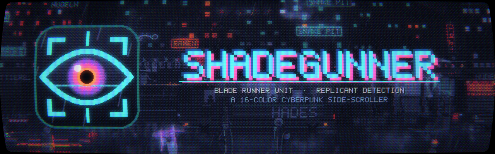</p>

# ShadeGunner — Android (Godot 4)

**English** · [Deutsch](README.de.md)

A 16-color cyberpunk side-scroller set in the Blade Runner universe. As a Blade
Runner you work your way from the outskirts to the Tyrell HQ, and you have to
**spot, scan and deactivate replicants among the passers-by** – and live with the
consequences of your decisions.

This is the **Android / handheld version** of [ShadeGunner](https://github.com/3p1cball-code/ShadeGunner):
a faithful re-implementation in **Godot 4 / GDScript**, not an emulator wrapper.
Same simulation, same city, same look – the procedural scene composed into 640×360,
Bayer-dithered against a 16-color palette and pushed through the CRT chain
(curvature, scanlines, shadow mask, bloom, phosphor persistence). Playable with
**touch, gamepad (e.g. Retroid Pocket) or keyboard**, on any screen shape from 10:9 (Retroid Pocket Classic)
to ~22:9. UI and in-game text in **German and English**.

**Download:** the signed APK (arm64, Android 7+) is on the
[Releases page](https://github.com/3p1cball-code/ShadeGunner-Android/releases/latest).

## Screenshots

| | |
|---|---|
| 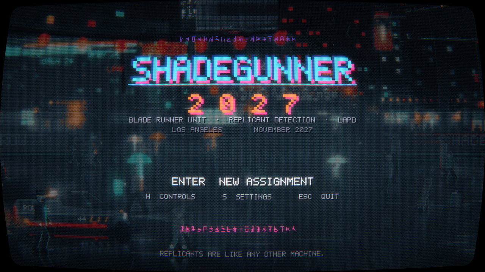 | 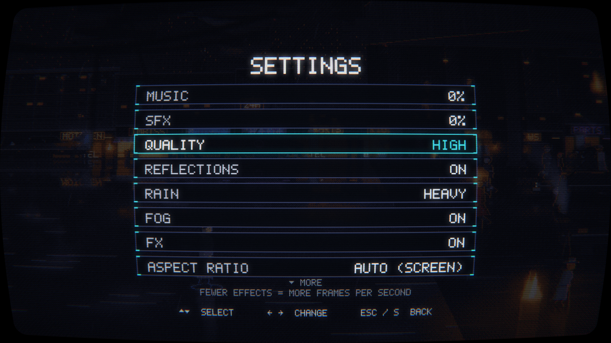 |
| 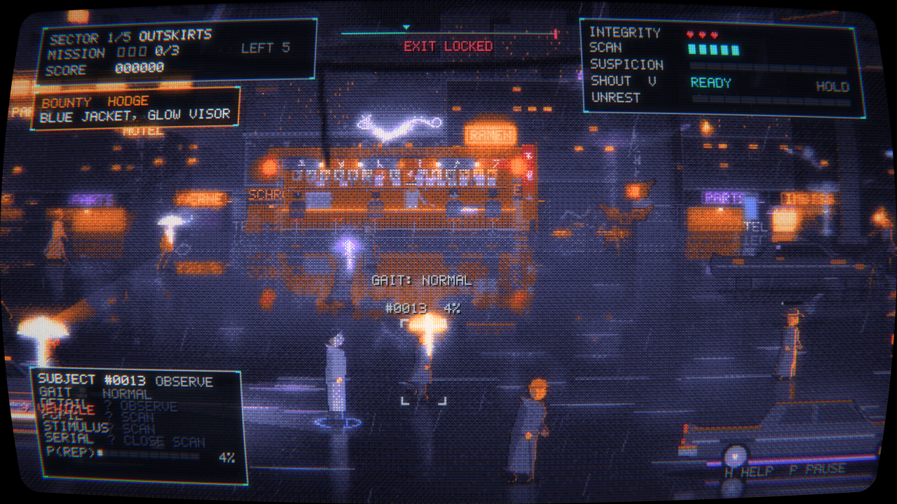 | 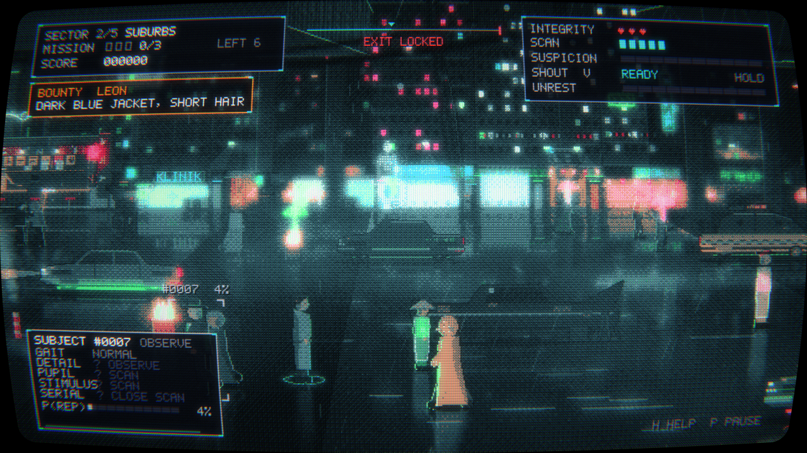 |
| 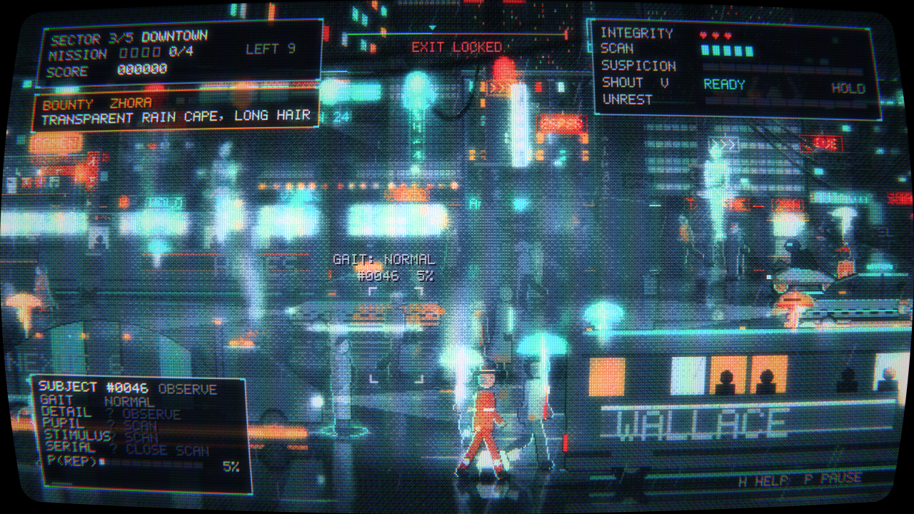 | 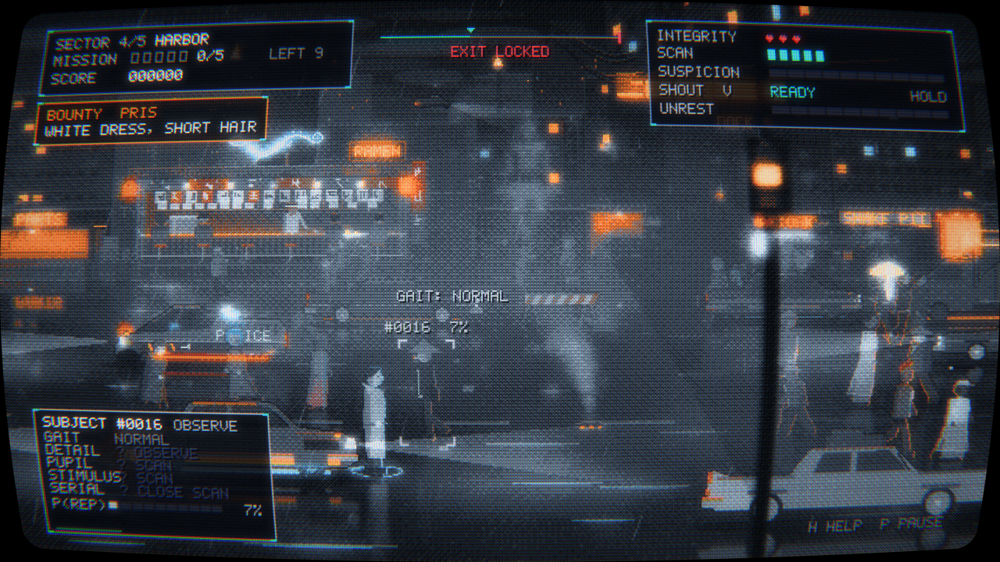 |
| 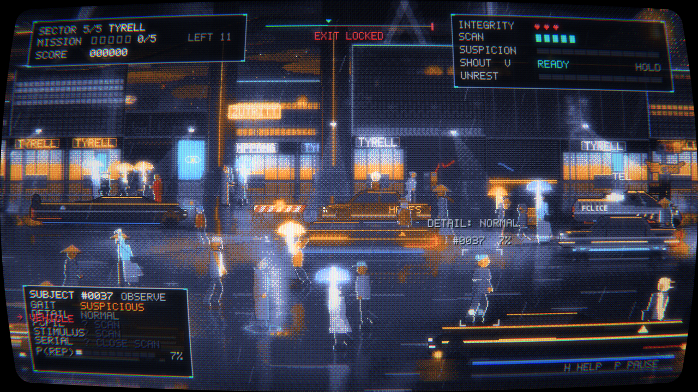 | 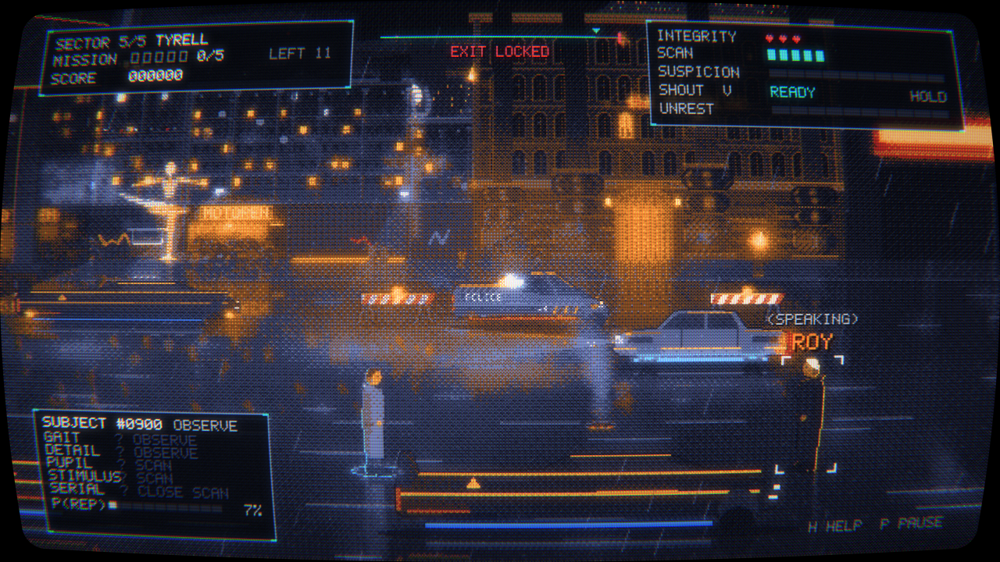 |

| Phone (20:9, touch) | Handheld (4:3, touch) |
|---|---|
| 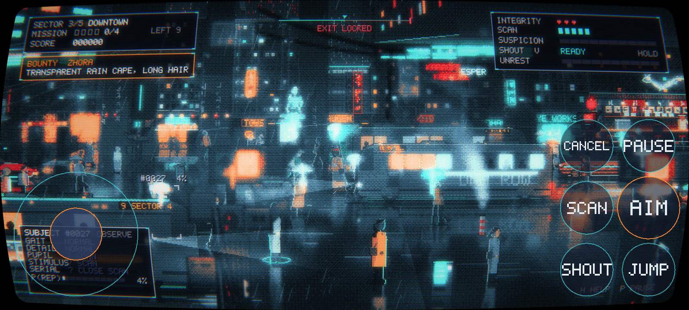 | 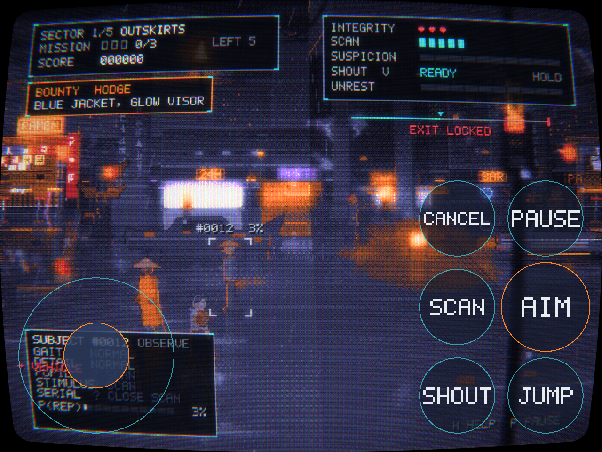 |

## Atmosphere first

The game is meant to be played calmly: walk through the city, take it in, have a
few moments that feel like the film. The mechanics serve the mood – and the
further you get, the denser and less readable the streets become, until the
question is no longer *who* is a replicant but whether it matters.

- **Own palette per quarter:** every zone has its own 16 colors built around one
  complementary pair plus a few close shades for highlights on the figures
  (outskirts amber ↔ blue/violet, suburbs green/cyan ↔ pink, downtown teal ↔
  signal red, harbor ash blue ↔ sodium, Tyrell gold ↔ deep blue).
- **Dense streets:** old ornate facades with retrofitted cables next to
  hyper-modern blocks, chalk-graffiti monoliths and ornamented columns, wrecks
  and trash in the outskirts (cleaner further in), **bridges and overhanging
  buildings** you walk underneath, pedestrian **signal towers** as free-standing
  objects (some right in front of the camera, slightly out of focus),
  **cables strung across the street** (single or in bundles), thin out-of-focus
  cables and lamps in the foreground, paper litter swirling in gusts, cyclists
  in small groups as pure scenery, a 60s sedan among the modern traffic, paper
  umbrellas with glowing shafts.
- **CRT phosphor:** near-white highlights smear a little longer, and fading
  trails get softer as they decay.

## Core loop

Observe → pick a target → **scan** (limited charges) → **tell confidence**
(Naive Bayes, calibrated against the zone's real replicant ratio) → aim/shoot
(passers-by in the line of fire catch the bullet) → meet the quota, the exit
opens → 1 of 3 upgrades. **Killing civilians ⇒ suspicion** (at 100 % the run is
lost).

When you catch an **eye reflex** – by watching, scanning, under a police
searchlight or in a blackout – the game's emblem (an eye in the scanner
reticle) flashes up above that person. It marks the tell, not the truth:
humans occasionally show a false reflex too.

- **Zones:** Outskirts → Suburbs → Downtown → Harbor → Tyrell.
- **Variety:** jumping (over barriers, barrels and bins – not over wrecks or
  parked cars – and dodging blows), traffic on two lanes,
  police searchlight (reveals eye reflexes), blackouts, bounty replicants,
  **landing police spinners** (the downdraft pushes everyone aside, then a
  ground check with a searchlight; the spinner blocks the median),
  **Gaff's origami** (one figure per zone: chicken, matchstick man, sheep,
  crane, unicorn; finding one = points + scanner refilled) and **noodle bars**
  in the White Dragon style (counter, patrons, cook, neon dragon; standing at
  the counter briefly refills one heart).
- **Full streets – and everyone is part of the simulation:** passers-by on the
  road, strollers on the rear sidewalk in front of the shops, and **groups
  standing around talking**. All of them can be observed and scanned; replicants
  hide in every kind. Difficulty EASY/NORMAL/HARD scales the crowd.
- **Addressing and shouting (`V`):** a short tap addresses the target ("You
  there! Stand still!"): humans raise their hands and answer, whoever has the
  STIMULUS tell just stares. Holding charges a shout to the crowd; on release,
  "LAPD! Everyone down!" rolls across the street as a visible wave, and each
  person reacts with their own moment of shock as it reaches them. Whoever has
  the STIMULUS tell stays **motionless**; the others **take cover** (the bullet
  passes over anyone crouching) or run. Every shout raises the street's
  **unrest**: more people run, replicants get nervous and bolt.
- **No two vehicles look alike:** body colors, accent colors (trim lines,
  two-tone roofs, skirts, racing stripes), underglow, brightness and lettering
  (Tyrell, Shimata, Pan Am, Off-World, Nexus 6, Eye Works …) are combined per
  vehicle – taxi roof signs, bus ad banners, bus route (e.g. "12 HADES") and
  truck lettering are random too. 32 variants per type.
- **Traffic turns into a column:** every quarter has more vehicles – and the
  denser the traffic, the slower it flows: stop-and-go, halted taxis, jam horns,
  usually 5–7 vehicles on screen downtown. And the slower and fuller it is, the
  **quieter** the engines. If you stand in a lane the driver honks and **brakes**
  – you only get run over if you dart in front of a car at the last second
  (truly dangerous up front, barely so in dense downtown traffic). Walk into a
  car from the side and you only get a brief **bump** (stun), no heart lost.
  Along the curb cars, taxis and trucks **park** (some with hazard lights); they
  are too tall to jump over and hide whoever is standing behind them.
- **Steaming manholes:** like in New York – manhole covers glowing in the crack
  and striped steam stacks that puff in bursts. In the steam you can barely see
  anything: whoever stands there is hard to observe.
- **Own music per quarter:** the outskirts with the title theme, then denser
  with each zone (arpeggios, choir, foghorn and harbor metal, Tyrell big and
  bright). Plus a beat-locked **rhythm track** – from a heartbeat in the suburbs
  to a driving sequencer in Tyrell – that grows louder with tension (aiming,
  unrest, flight, suspicion, ROY) and slowly fades again.
- **Holographic ballerinas** (Blade Runner 2049): giant dancers above the roofs
  and small ones on projector pedestals on the sidewalk – pirouette, seconde,
  arabesque with promenade, scanlines, dropouts, glitches; they go dark during a
  blackout.
- **Syd Mead traffic:** police spinner with a capsule cockpit and wheel pods,
  Deckard's sedan, metro-cab with a glass dome, Sebastian's armadillo truck,
  aerial limousine, a city bus full of passengers, a motorcycle with disc wheels.
- **Finale:** Tyrell is a long last sector. Toward the end the city empties –
  derelict blocks, shutters, ornate columns – until **J. F. Sebastian's house**
  (the Bradbury). **ROY** stands in front of it and waits until you come close.
  In the fight he only taunts you with lines from the film. Once he has beaten
  you down to **one heart** he lets go and stands defenseless: one shot is
  enough. If you don't shoot, he speaks – *tears in rain* – dies on his own, and
  a dove rises. The ending reflects which way you chose. The exit only opens once
  the quota is met and ROY is no longer standing.

## Controls

| Touch | Gamepad | Keyboard | Action |
|---|---|---|---|
| stick (left) | D-pad / left stick | `A/D`, `W/S`, arrows | walk, depth (near/far) |
| tap a person | `L1` | `Q` / `Tab` | cycle target |
| SCAN | `X` | `R` | scan selected target |
| AIM (hold, release) | `R1` or `R2` (hold, release) | `E` (hold, release) | aim, fire |
| CANCEL | `B` | `C` | lower weapon |
| SHOUT (tap / hold) | `Y` | `V` | address target / shout "LAPD! Everyone down!" |
| JUMP | `A` | `Space` | jump |
| – | `L2` | `Shift` | sprint |
| PAUSE | `Start` | `P` / `Esc` | pause (menus: settings, help) |

Menus work with touch (tap rows and cards), D-pad + `A`, or arrow keys + `Enter`.
The Android back gesture pauses. Touch controls: AUTO (shown on touch screens), ON or OFF.

## Settings and performance

The scene is composed on the CPU like in the original, so the frame rate depends on
the device. Settings let you trade effects for frames:

- **Quality** HIGH / MEDIUM (default on Android: no reflections) / LOW sets
  **reflections**, **rain** (heavy/light/off), **fog** and **FX** in one go; each can
  then be toggled on its own. On a handheld start with **LOW**.
- **Aspect ratio** AUTO: the internal width adapts to the screen (height 360, width
  400–960) – no letterbox and no cropping, same scale on every device.
- **Display** CRT or **TEXT** (the scene as ASCII characters in the palette colors,
  still through the CRT chain), scanlines, music/effects volume, difficulty, language.

## Port notes

- **1:1 with the Python original:** constants and tables are exported from the
  Python modules (`tools/export_data.py`); the simulation is step-for-step identical
  (`tests/test_sim_parity.gd` replays 25 517 steps against a trace of the original:
  0 deviations), Python's `random` is reproduced bit-exactly (`src/core/pyrandom.gd`),
  and QPainter is re-built on Godot's RenderingServer (`src/core/qp.gd`). HUD, sound
  calls, sprites, vehicles, city layers and the full scene are pixel-compared against
  the original (`tools/*_reference.py`).
- **Own palette per zone** is passed to the dither shader as a uniform; the HUD keeps
  `noir16`.
- **Port-specific speed-ups:** wet-street reflections are drawn by a shader instead of
  baking a blurred image per sprite frame, radial gradients use a cached 2D texture,
  the perspective ground and reflection bands are single draw calls.
- Gamepad on a handheld: digital shoulder buttons report a button, not an
  analog trigger axis, and Godot has no `JOY_BUTTON_L2/R2` constants - that is why
  **aim/fire sits on `R1`** (the R2 axis works as well). `--joydebug` prints every
  gamepad button/axis index if a button ever seems unresponsive.
- Test cheat (keyboard): type `giveall` anywhere (immortal, exit always open);
  `giveall1`–`giveall5` jumps straight into sector 1–5.

## Build

```sh
godot --path . --rendering-driver opengl3            # run on desktop
godot --headless --path . --export-release "Android" build/shadegunner.apk
```

Needs the Godot 4 export templates, JDK 17 and the Android SDK. `export_presets.cfg`
is not in the repo (it holds the signing setup) – start from
`export_presets.cfg.example`. Tests: `godot --headless --path . --script res://tests/test_sim.gd`
(and the other scripts in `tests/`).

## License

MIT. An independent fan project; Blade Runner is a trademark of its owners.
