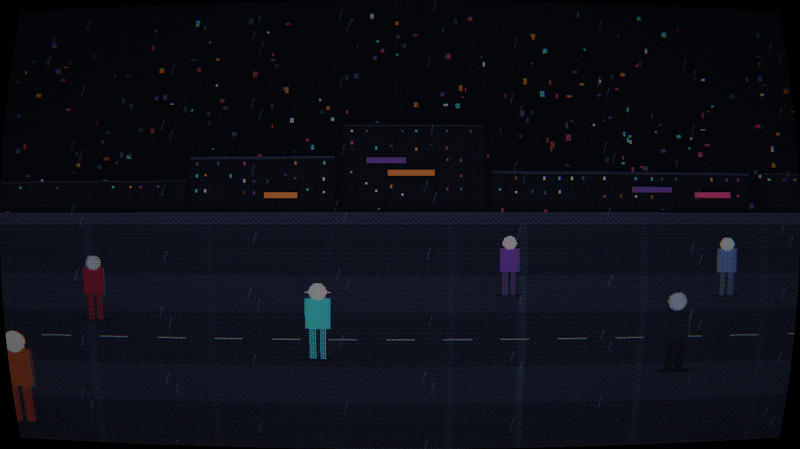

# ShadeGunner (Android)

A Godot 4 port of **ShadeGunner** — the 16-color cyberpunk side-scroller set in
the Blade Runner universe. Same `noir16` palette, same Bayer ordered dithering,
same CRT chain (curvature, scanlines, shadow mask, bloom, grain, phosphor
glow) — rewritten in GDScript so it runs as a native Android app.

No emulation, no PyQt, no Python runtime. Godot exports a real APK.

> **Work in progress.** The render pipeline and a procedural street already run
> and look like the original; the game loop is being built next.



## How the render chain works

The original composes a 640×360 scene on the CPU, ditheres it against a fixed
palette and runs it through a CRT shader. The port keeps that architecture:

```
procedural scene (SubViewport 640×360)
      │
      ▼
dither.gdshader   grad + Bayer 8×8 + nearest palette (noir16)
      │
      ▼
crt.gdshader      curvature, scanlines, shadow mask, bloom, grain, vignette
      │
      ▼
TextureRect       nearest-upscaled to the screen, letterboxed for non-16:9
```

The palette lives in one place (`src/palette.gd`) and is handed to the shader as
a uniform array, so scene and palette cannot drift apart.

## Layout

| Path | What |
|---|---|
| `project.godot` | Godot project (640×360 internal, GL Compatibility for Android) |
| `main.tscn`, `src/main.gd` | entry point, builds the three-stage render chain |
| `src/world.gd` | procedural street / belt-scroller (PoC) |
| `src/config.gd` | balancing + layout constants, 1:1 from the original `config.py` |
| `src/persp.gd` | belt-scroller perspective (world → screen), 1:1 from `persp.py` |
| `src/palette.gd` | `noir16` palette |
| `shaders/dither.gdshader`, `shaders/crt.gdshader` | the post-processing chain |

## Running on the desktop

```bash
godot --path .             # needs Godot 4.7+
```

Offscreen render to PNG (used to verify the look without a device):

```bash
godot --path . -- --shot=shots/out.png --frames=45
```

## Roadmap

1. **PoC** — render chain + one procedural zone (done)
2. **Game loop** — pedestrians, observe/scan, tell confidence (Naive Bayes),
   shoot, suspicion, quota, exit, upgrades
3. **Full build** — zones, traffic, events (blackout, searchlight, spinner
   landing, origami, ramen), ROY, sound, menus, bilingual UI, highscore
4. **APK** — Android export, tested on a device

## Credits

A port of [ShadeGunner](https://github.com/3p1cball-code/ShadeGunner) by
Alexander Riedel. Render path originally from `asciiplay`. MIT.
