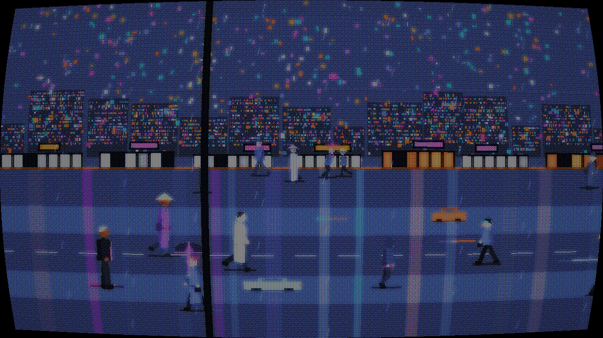
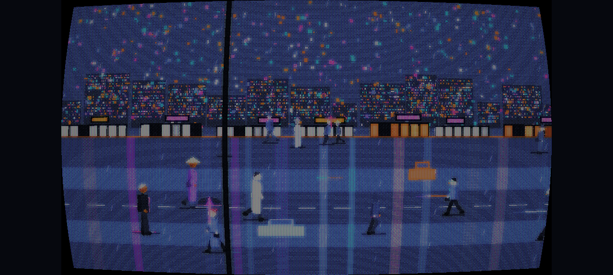
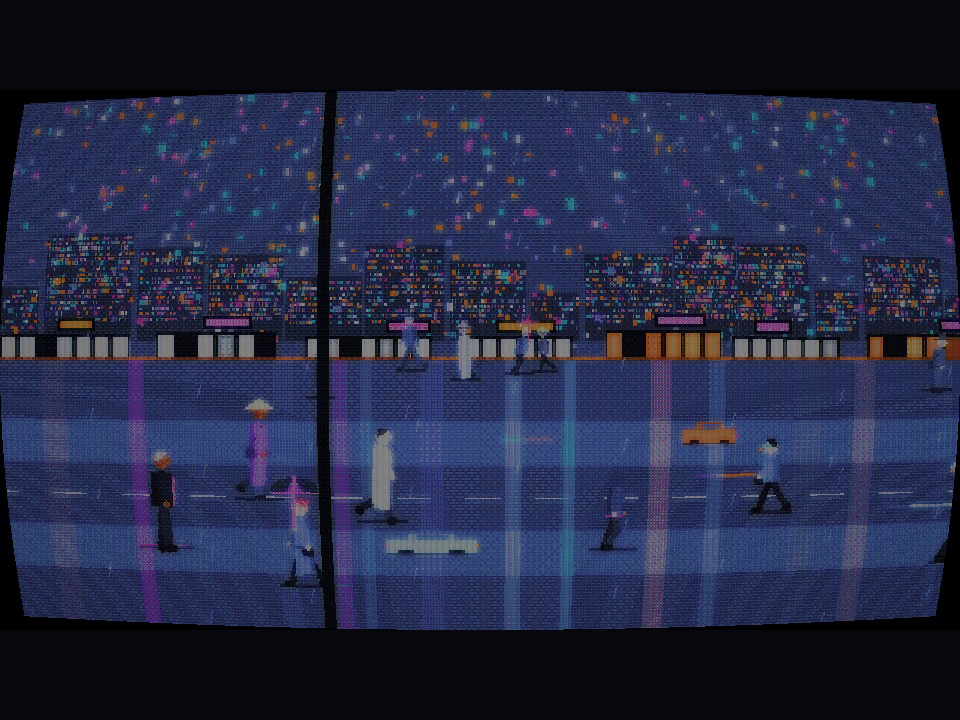

# ShadeGunner — Android port (Godot 4)

[Deutsch](README.de.md) · **English**

A faithful re-implementation of [ShadeGunner](../ShadeGunner) as a native Android
game, written from scratch in **Godot 4 / GDScript**. The point of the port is to
put the same 16-colour Blade-Runner look on a phone without emulation — the
Windows build could not be emulated on Android/ARM, so this is a real port, not a
wrapper.

## What you see

The same render chain as the original Python game:

```
procedural scene (640x360, CPU)
  → post shader: grading + 8x8 Bayer dither against the noir16 palette
  → CRT: curvature, scanlines, shadow mask, bloom, grain, hum bar, vignette
  → nearest-neighbour upscale, letterboxed to the window
```

| 16:9 (desktop) | 20:9 (phone) | 4:3 |
|---|---|---|
|  |  |  |

The internal frame is always **640×360**; the window aspect only decides the
letterbox/pillarbox bars, so the pixels stay square and the dither pattern stays
identical at every resolution. Verified at 16:9, 20:9 and 4:3.

## Figures

Passers-by are skeleton-animated sprites, ported 1:1 from `render/sprites.py`:
a small joint rig (hip, knee, ankle, shoulder, elbow, hand, head) in design units
(48 u tall, feet at the origin). The pose is computed analytically per frame from
(animation, phase) and drawn without anti-aliasing, so silhouettes stay crisp at
every depth. Outfits (trenchcoat, long coat, dress, transparent rain cape,
hoodie, suit, overalls…), heads (hats, hoods, mohawk, glow visor…), glowing
umbrellas, LED clothing and the scanner/gun poses are all there.

## Status

Implemented: render chain, palette (`noir16`), procedural street with towers,
shopfronts, neon signs, wet-road reflections, vehicles, rain, and the animated
crowd including the player figure.

**Not yet implemented** (next milestone): the game loop (observe → scan →
tell-confidence → shoot), suspicion/quota, upgrades, HUD, menus, sound, touch
controls. Right now the street simply scrolls — it is a look-and-feel build.

## Build

**Run on desktop**

```sh
godot --path . --rendering-driver opengl3
```

**Android APK**

```sh
godot --headless --path . --export-debug "Android" build/shadegunner.apk
```

Needs the Godot 4 export templates, JDK 17 and the Android SDK (build-tools,
platform-tools). The debug keystore is generated by Godot on first export.

## Palette

`src/palette.gd` is the single source of truth for the 16 `noir16` colours. The
shader has them embedded (generated), so scene and palette can never drift apart.

## Credits / licence

MIT. An independent re-implementation; Blade Runner is a trademark of its
owners — this is a fan project.
